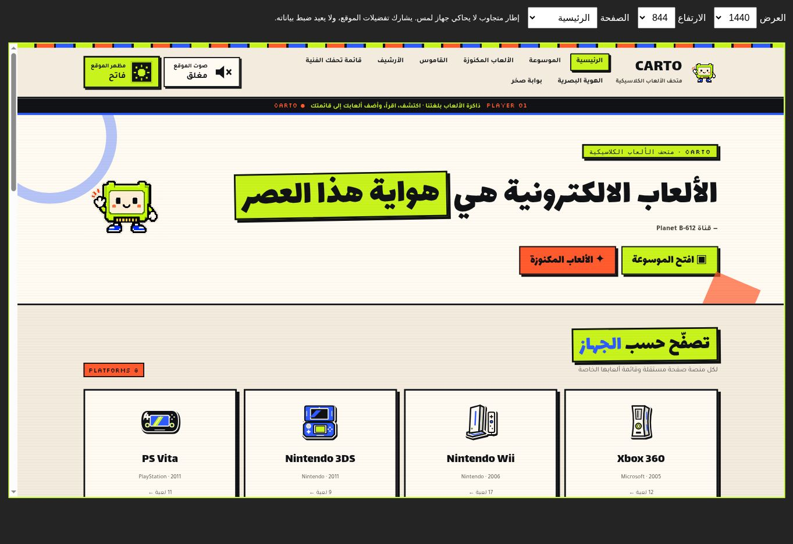
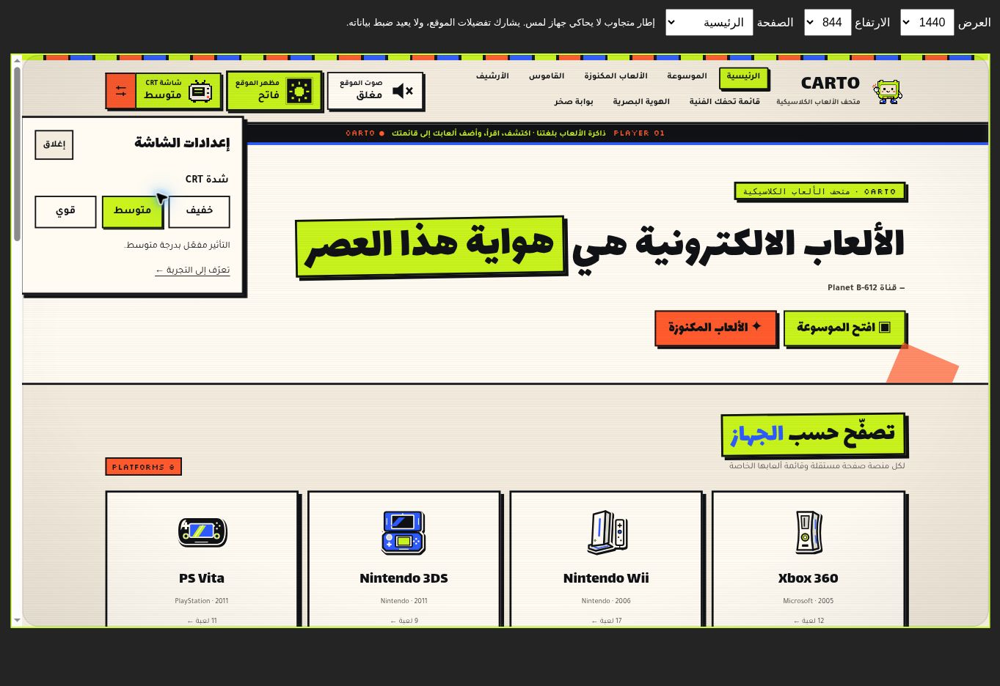
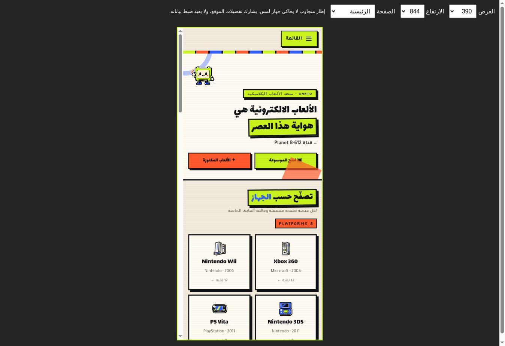
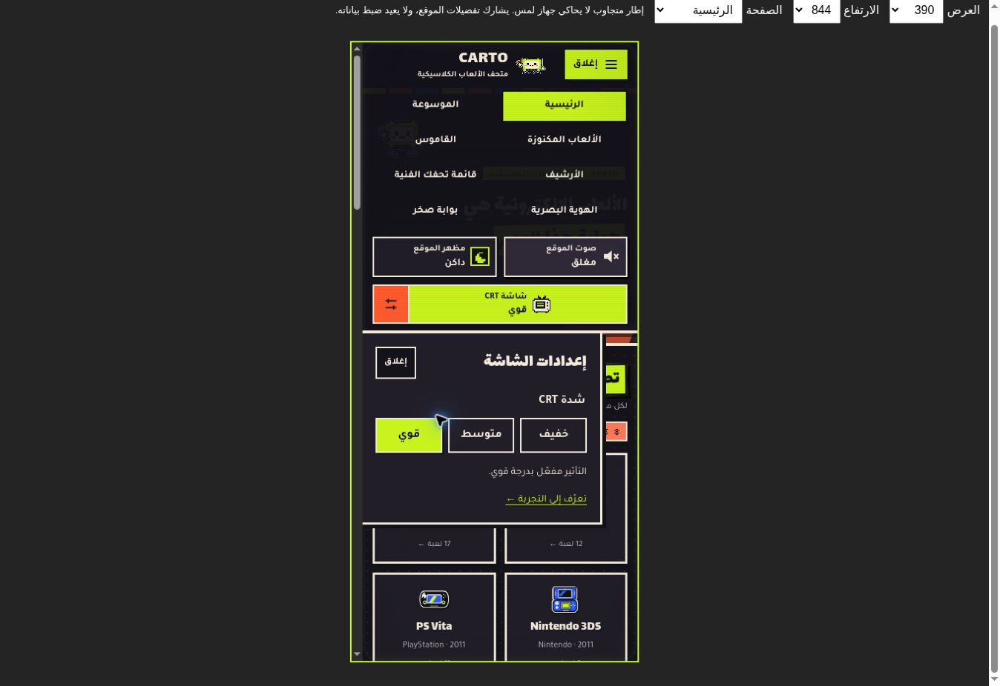
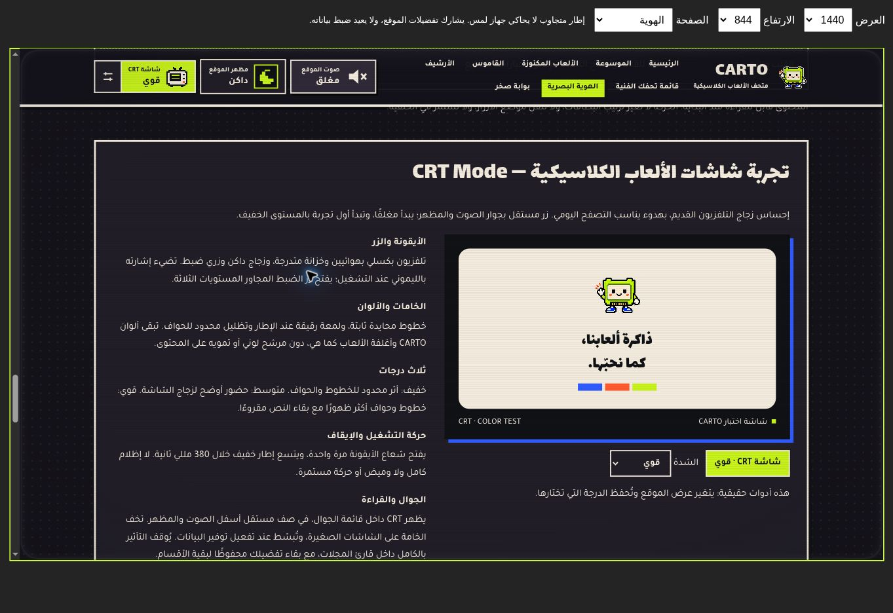

# CRT Mode — تقرير التنفيذ والتحقق

## النطاق والقرار

إضافة وضع CRT اختياري إلى CARTO، دون تغيير بيانات الألعاب أو صورها أو روابطها أو مفاتيح القائمة الشخصية والصوت والمظهر. بُني العمل على commit `793a4d07cd26107dda298c7bf47000dec00dbb15` بعد مراجعة آخر خمسة تحديثات. بقي قارئ المجلات بوظائفه وتصميمه؛ يُوقف تأثير CRT في القارئ بالكامل.

| التقنية | الدراسة | القرار |
| --- | --- | --- |
| CSS | تدرجات ثابتة للخطوط والحواف، مع إبقاء النص والصور عناصر HTML أصلية. انتقال محدود إلى transform وopacity. | الاختيار المناسب لهذه الميزة. |
| Canvas 2D | مناسب لرسوم أو شاشة لعبة مرسومة، لكنه لا يطبق انحناءً على محتوى DOM تلقائيًا. تحويل واجهة كاملة إلى صورة يعقّد النص العربي والتفاعل والإتاحة. | لا حاجة لإدخاله. |
| WebGL | يتيح معالجة بصرية أدق للصور المرسومة، مع إدارة سياق وذاكرة ورسوم ومعالجة فقدان السياق. | تعقيد غير مطلوب لتأثير هادئ فوق واجهة عربية. |

المقارنة قرار هندسي مبني على نطاق CARTO، وليست قياسًا عامًا يزعم أن CSS أسرع من WebGL في كل استعمال.

## المراجع

- [MDN — repeating-linear-gradient](https://developer.mozilla.org/en-US/docs/Web/CSS/Reference/Values/gradient/repeating-linear-gradient): رسم خطوط المسح دون ملفات خامات.
- [web.dev — High-performance CSS animations](https://web.dev/articles/animations-guide): حصر الحركة القصيرة في transform وopacity وتجنب إعادة تخطيط المحتوى.
- [MDN — Canvas](https://developer.mozilla.org/en-US/docs/Web/HTML/Reference/Elements/canvas): سياق الرسم واختلافه عن عناصر الصفحة الأصلية.
- [MDN — WebGL best practices](https://developer.mozilla.org/en-US/docs/Web/API/WebGL_API/WebGL_best_practices): إدارة الذاكرة والسياق وجودة الرسوم.
- [W3C — prefers-reduced-motion](https://www.w3.org/WAI/WCAG22/Techniques/css/C39): إلغاء الحركة غير الضرورية عند طلب تقليلها.
- [W3C — Three Flashes](https://www.w3.org/WAI/WCAG21/Understanding/three-flashes): تجنب الوميض المتكرر؛ لم يُضف وميض إلى الميزة.
- [MDN — localStorage](https://developer.mozilla.org/en-US/docs/Web/API/Window/localStorage): حفظ التفضيل بين الزيارات، مع معالجة تعذر التخزين.

## التصميم والسلوك

- تلفزيون SVG بكسلي أصلي على شبكة 40 وحدة: هوائيان وخزانة متدرجة وزجاج وزرا ضبط وإشارة تشغيل. مستقل عن رموز المظهر والصوت.
- الزر الرئيسي يبدّل فورًا، والزر المجاور يفتح لوحة غير حاجبة للمستويات: خفيف، متوسط، قوي. كل حالة مكتوبة وaria-pressed يتزامن معها.
- CRT مغلق لأول زيارة، وأول تشغيل يستخدم «خفيف». التفضيل المستقل `carto-crt-v1` يحتوي enabled وlevel فقط. تبقى الدرجة المختارة عند إيقاف CRT.
- طبقة ثابتة غير قابلة للنقر: خطوط محايدة كل 3 بكسلات، وتظليل رقيق في الأطراف ولمعة محدودة في الإطار. الانحناء إيحاء من الحواف المستديرة، دون تحويل أو قص الصفحة أو ثنيها.
- لم تُستخدم مرشحات لونية أو blur أو text-shadow للمحتوى. تستبدل الميزة طبقة scanlines القديمة التي كانت موجودة دائمًا؛ لا تتراكم طبقتان.
- إطار يتسع مرة واحدة خلال 380ms، مع فتح شعاع الأيقونة 340ms. لا إظلام كامل، ولا اهتزاز، ولا حركة خلفية مستمرة. تُلغى الحركة في reduced-motion وتوفير البيانات.
- على الجوال: يبقى زر القائمة الصغير الحالي؛ يظهر CRT بصف داخلها أسفل الصوت والمظهر. تُخفف شدة الطبقات، وتبقى أهداف اللمس 44px على الأقل. تُحصر لوحة الإعدادات داخل الشاشة.
- عند توفير البيانات: خطوط ثابتة وإطار بسيط، دون اللمعة والتظليل المركّب. عند الألوان الإجبارية والطباعة تُخفى الخامة.
- في قارئ المجلات: لا تُنشأ طبقة CRT ولا انتقال الإطار. يبقى الاختيار محفوظًا للأقسام الأخرى، بما فيها عند العودة من القارئ.

## الملفات

- `assets/crt.js`: مالك التفضيل، الزران، لوحة الشدة، مزامنة الحالات والتخزين وتقليل الحركة وحماية القارئ.
- `assets/crt.css`: الأيقونة، الطبقات الثابتة، الانتقال، التجاوب، الألوان الإجبارية والطباعة، وتنسيق عرض الهوية.
- `scripts/build-performance.py`: إدراج المصدرين في الحزمتين المشتركتين، بنفس ترتيب الاعتماديات الحالي.
- الصفحات الـ13: تحديث مراجع الحزمتين فقط، وإضافة قسم الهوية في `identity.html` مع رابط وصول ومعاينة متزامنة حقيقية. لم تتغير قائمة الألعاب أو روابطها.
- `tests/crt.test.cjs`: اختبارات التفضيلات والعزل والتخزين والحماية والحركة والمزامنة.
- `tests/responsive.html`: إضافة 1024 و1440 ومعاينة تلائم نافذة الفحص مع احتفاظ iframe بعرض CSS المطلوب.
- `assets/dist/manifest.json` والحزمتان المولّدتان: نتائج البناء الحتمية.

## التحقق المحلي قبل الرفع

### مصفوفة التخطيط

جرت جولتان محددتان عبر المتصفح السحابي: جولة أولية، ثم تأكيد بعد إصلاح موضع لوحة الشدة. كل جولة شملت 20 صفحة ومسارًا × 4 مقاسات: 1440، 1024، 390، 360. الجولة الأولى بالمظهر الفاتح، والثانية بالداكن، مع CRT قوي. يحتوي [ملف النتائج](browser-matrix.json) قياسات DOM والحالة لكل حالة، وليس ادعاءً بمراجعة لقطة مستقلة لكل واحدة من الحالات الـ160.

شملت المسارات الرئيسية والموسوعة والمكنوزة والقاموس والأرشيف والتعريب والقائمة الشخصية والهوية والمصادر وصخر والمجلات والقارئ ومكتبات الأجهزة الثمانية. فُحصت لقطات تمثيلية للكمبيوتر والجوال، ولوحة الشدة والتفاصيل والقائمة وقارئ المجلات وقسم الهوية.

### التفاعل الفعلي

- تشغيل وإيقاف CRT بالفأرة ولوحة المفاتيح؛ الإيقاف يخفي العدسة فورًا.
- اختيار الدرجات الثلاث، وتحديث الحالة المرئية، وحفظها بعد إعادة التحميل وبين الأقسام.
- فتح لوحة الشدة وإغلاقها، واستخدام Escape، والتحقق من بقائها داخل العرض على الكمبيوتر والجوال.
- تبديل الفاتح/الداكن وتشغيل/كتم الصوت مع بقاء CRT مستقلًا.
- فتح تفاصيل Minecraft، ثم حفظها وتصنيفها بالقائمة، وتبديل CRT دون فقد اللعبة، ثم تغيير التصنيف والتصفية. أُزيل سجل الاختبار الذي أُنشئ محليًا بعد الفحص.
- التنقل عبر رابط القاموس والبحث عن RPG، مع بقاء التفضيل.
- فتح مكتبة المجلات بأغلفتها الأصلية، وفتح عدد Resident Evil 4 (32 صفحة)، والانتقال من 1 إلى 2، وفتح أدوات القراءة؛ العدسة غائبة وfilter وtransform على صفحة القراءة محايدان.
- اختيار درجة من عرض الهوية التفاعلي وتأكيد تحديث زر الشريط العلوي.
- لم تُرصد أخطاء تخص CRT في سجل Console. ظهرت رسائل من إضافة المتصفح السحابي نفسها، لا من ملفات الموقع.

### الاختبارات الآلية

سبعة اختبارات CRT: البدء مغلقًا/خفيفًا، عزل المفاتيح، التفضيلات غير الصالحة، التخزين المحجوب، حماية القارئ، الحركة مع reduced-motion وإلغاؤها عند تغيره، ومزامنة storage وعودة bfcache. إضافة إلى اختبارات المشروع القائمة. تُسجل نتيجة فحص GitHub النهائية في ملخص التسليم.

## الأداء والحدود

- إضافة JavaScript: 8,585 bytes؛ CSS: 8,411 bytes. زيادة الحزمتين المشتركتين: 17,000 bytes قبل الضغط، و4,267 bytes مع gzip بالمقارنة مع النسخة السابقة.
- صفر مكتبات جديدة، وصفر صور/خامات جديدة مطلوبة للميزة، ولا requestAnimationFrame أو setInterval أو رسوم متكررة. الطبقة fixed ولا تغيّر هندسة الصفحة عند التبديل.
- المقاسات اختُبرت داخل iframe متجاوب، لا على أجهزة لمس فعلية. لم يتوفر اختبار مستقل على Safari/Firefox أو هواتف ضعيفة فعلية، ولم يُقَس FPS أو استهلاك البطارية.
- اختُبر مسار reduced-motion آليًا مع تهيئة حقيقية للوحدة وCSS الوقائي؛ لم يتغير إعداد نظام التشغيل في المتصفح السحابي. لا يُدّعى اختبار نظام تشغيل فعلي لهذا الخيار.
- بعض ملفات PDF الكبيرة غير موجودة في نسخة العمل المحلية؛ تُنفذ اختبارات سلامتها في GitHub حيث يوجد المستودع الكامل. جُلبت نسخ مطابقة لـSHA من أغلفة المجلات وحزم أول صفحات العدد للتحقق المحلي؛ لم تُغيّر هذه الملفات في المستودع.

## ملاحظة موجودة قبل CRT وخارج النطاق

عند 1024px، يتجاوز غلاف مائل في مقدمة مكتبة المجلات حدود المحتوى بحوالي 6px. ظهرت القياسات نفسها قبل CRT وبعده: scrollWidth=1015 مقابل clientWidth=1009. جرت المقارنة بنسخة HTML السابقة التي تستخدم حزمتها السابقة دون وحدة CRT. بقيت هذه الملاحظة موثقة دون تعديل تصميم المجلات خارج نطاق الإضافة.

## لقطات المقارنة

اللقطات من إطار الاختبار المتجاوب؛ مقاس 1440 معروض مصغّرًا ليلائم نافذة المتصفح دون تغيير عرض CSS الداخلي.

| الحالة | قبل | بعد |
| --- | --- | --- |
| الكمبيوتر 1440 |  |  |
| الجوال 390 |  |  |

## الرجوع

التغيير معزول في commit الميزة. يمكن التراجع عنه بـgit revert مع إعادة البناء؛ لا يحتاج التراجع إلى حذف تفضيلات الصوت أو المظهر أو القوائم. يبقى مفتاح CRT وحده غير مستخدم بعد التراجع.
