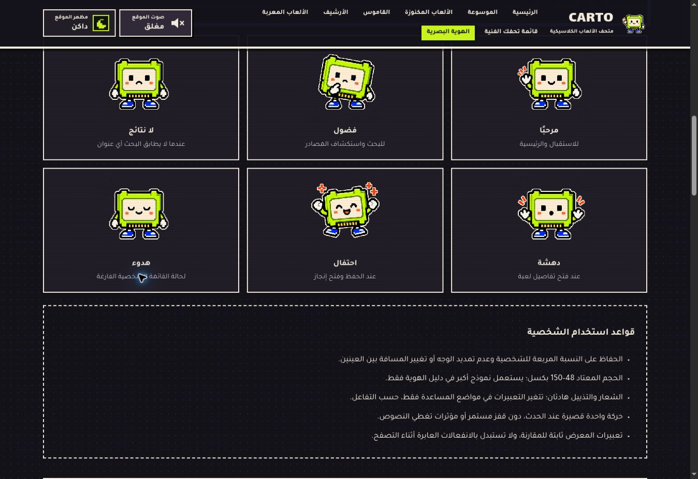
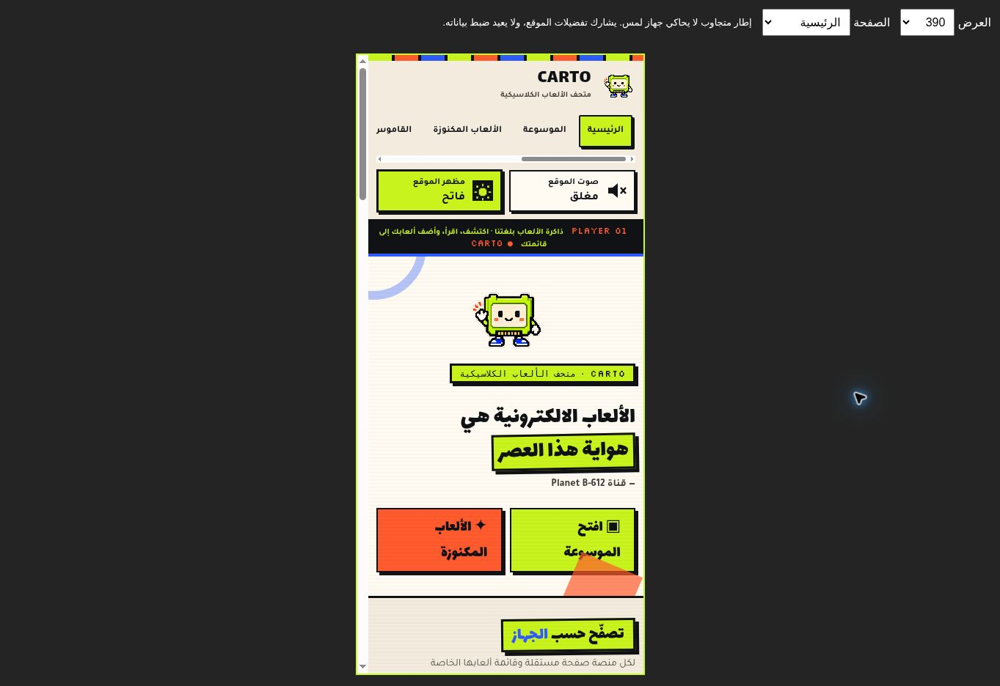
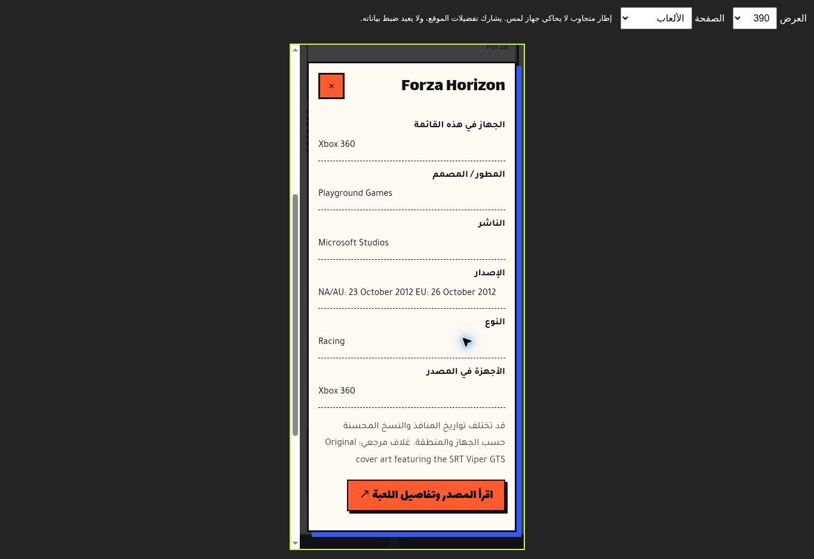

# CARTO — تقرير المرحلة الثالثة

التاريخ: 30 أكتوبر 2026.

## التنفيذ

- شخصية جديدة بالكامل على هيئة شريط ألعاب، بوجه أبسط ونسب مربعة وأطراف قصيرة وحافة ملصق. ستة تعبيرات: ترحيب، فضول، لا نتائج، دهشة، احتفال، هدوء.
- جميع التعبيرات في ملف WebP شفاف واحد بحجم 252,970 بايت، دون مكتبات أو canvas أو حلقات تحريك. الشعار ثابت، والتعبيرات تتغير عند الأحداث فقط، مع احترام تقليل الحركة.
- توزيع الشخصية في الرئيسية والبحث والتفاصيل والقائمة الفارغة والمكنوزة والأرشيف والمصادر والتذييل؛ لا طبقات عائمة تعترض المحتوى.
- استبدال المصطلحين القديمين بمصطلح «شريط ألعاب» في النصوص العامة. ملفات الرسومات القديمة تبقى متاحة للروابط الخارجية، لكن الواجهة تستخدم الشخصية الجديدة.
- محرك Web Audio جديد، بنغمات مؤلفة داخل الكود: عودة هابطة، اكتشاف كنز، فتح، نجاح حفظ، احتفال إنجاز، تحول مظهر، تشغيل وإيقاف مختلفان، ونقرة تنقل هادئة. لا ملفات صوتية مقتبسة ولا أصوات Zelda.
- الصوت مغلق للزائر الجديد؛ اختيار الزائر العائد محفوظ. لا صوت قبل التفاعل، ولا أصوات متكررة مع الكتابة والتمرير. نغمة الإيقاف قصيرة أخيرة، ثم الصمت. للإنجاز أولوية تمنع طمس نغمته بالحفظ.
- عند تشغيل الصوت تؤخر الروابط الداخلية التنقل لإكمال النغمة بحد أقصى 260 مللي ثانية؛ الروابط المعدلة بمفاتيح Ctrl/Cmd تظل طبيعية.
- زرا المظهر والصوت بأيقونات هندسية وحالة مكتوبة ووصف لقارئ الشاشة وحركات قصيرة؛ لا اعتماد على الأيقونة أو اللون وحدهما.
- تنظيم صفحة الهوية: الشعار، الشخصية والتعبيرات، قواعد الاستخدام، القصة والألوان والخطوط، أزرار حقيقية، توقيت الحركة، مختبر لتجربة النغمات الثماني، والتحسينات السابقة. الاحتفاظ بالروابط الداخلية السابقة.

## حماية المحتوى والبيانات

لا تغيير لبيانات الألعاب: 104 ألعاب للمكتبة و57 لعبة مكنوزة. لا إعادة ضبط ولا تغيير لبنية مفاتيح `carto-personal-wishlist` و`carto-arcade-achievements-v1` و`carto-appearance` و`carto-sound`. رسائل الحفظ والإنجاز تلي نجاح التخزين فقط.

## الاختبارات الآلية

`node --test tests/*.test.cjs`: ثمانية اختبارات ناجحة، تشمل اكتمال بيانات 161 عنوانًا، اتساق التنقل والمسارات المحلية، حفظ المظهر وحالاته، حبس التركيز واستعادته في النوافذ، تميز النغمات وحدود مدتها وعدم التشغيل التلقائي، حفظ بيانات القائمة والإنجازات أثناء تبديل الصوت، وربط الصفحات بالأصول المشتركة والتعبيرات الستة. الاختبار الثامن يتحقق من عتبة 10 ألعاب لإنجاز الجامع و5 ألعاب مختومة لإنجاز الخبير، وعدم تكرار الإنجاز أو إعلانه عند فشل التخزين، مع الحفاظ على إنجاز سابق.

نجح فحص بناء جملة جميع ملفات JavaScript و`git diff --check`. عولج صغر تسمية الشعار وتباينها وحشو حاوية جدول الحركة بعد الفحص التصميمي. بقيت ألوان الورق والليموني وحواف الملصقات لأنها جزء من هوية الموقع الموجودة.

## فحص المتصفح السحابي

- اكتمل نشر GitHub Pages بنجاح. شملت الجولة 16 مسارًا: الصفحات التسع المستقلة وصفحات الأجهزة السبعة.
- 64 قياس تخطيط: 16 مسارًا × مظهرين × إطارين بعرض 360 و1366 بكسل؛ لا تجاوز أفقي لجذر الصفحة. يعرض Chrome شريط تمرير بعرض 15 بكسل داخل الإطار. قائمة التنقل الهاتفية تسمح بالتمرير الأفقي عمدًا.
- فُحصت الرئيسية والمكنوزة ونافذة التفاصيل بصريًا عند 390 بكسل، ودليل الهوية عند 430 و768 بكسل أيضًا. روجعت الشخصية وتعبيراتها الستة في المظهرين.
- عولج تعارض زر معاينة المظهر مع إنشاء زر التنقل، وأضيفت حالته إلى اختبار المظهر. عولجت قاعدة قديمة تمسح صورة الشعار الداكنة، وأُصدرت نسخ محدثة من روابط الأصول لمنع بقاء الكود السابق في الذاكرة المؤقتة.
- البحث العشوائي يعيد صفر نتائج مع تعبير حزين ثابت؛ بحث Forza أعاد لعبة واحدة. تصفية Nintendo DS أعادت 10 ألعاب.
- فُتحت تفاصيل Forza Horizon، وتحقق احتواء التركيز مع Tab وShift+Tab، والإغلاق بـEscape واستعادة التركيز إلى زر التفاصيل.
- حُفظت Forza Horizon في تصنيف اللعب الحالي، وظهرت بعد الانتقال إلى القائمة. حُفظت Advance Wars من المكنوزة في قائمة الرغبات، ونُقلت إلى المختومة. أُزيلت لعبتا التجربة بعد التحقق؛ لم تُمسح بيانات المتصفح.
- ظهر إنجاز «أول اكتشاف» عند فتح التفاصيل؛ استمر ظهوره إلى جانب «جسر اللغة» في الرئيسية (2/4). عتبتا الجامع والخبير اختُبرتا آليًا في بيئة معزولة، دون إضافة عشر ألعاب إلى بيانات المستخدم الفعلية.
- نجحت معاينات النغمات الثماني عبر Web Audio، وتزامنت أزرار الصوت الثلاثة إلى الإيقاف، وتعطلت معاينات الصوت الثماني عنده. لم يجر تقييم سمعي بشري.
- تزامن زر المظهر داخل دليل الهوية مع الزر الرئيسي في الاتجاهين، وحُفظ الاختيار أثناء الانتقال بين الصفحات. أُعيد الوضع الفاتح والصوت المغلق في نهاية الفحص.
- الروابط الداخلية المحلية ووجود ملفاتها وفُرادة مسؤول المظهر مفحوصة آليًا؛ لا يدعي هذا التقرير فتح كل رابط خارجي أو ضمان توفر خدمات الصور والمصادر الخارجية.

## حدود الفحص

فحص الجوال في المتصفح السحابي يستخدم إطارًا بعرض محدد، وليس هاتف لمس فعليًا. التحقق من الصوت يعتمد تشغيل واجهة Web Audio وحالاتها؛ لا يمثل تقييمًا سمعيًا بشريًا لجودة النغمات. لا يمكن ضمان استمرار البيانات بعد حذف المستخدم لبيانات متصفحه.

## لقطات التوثيق

