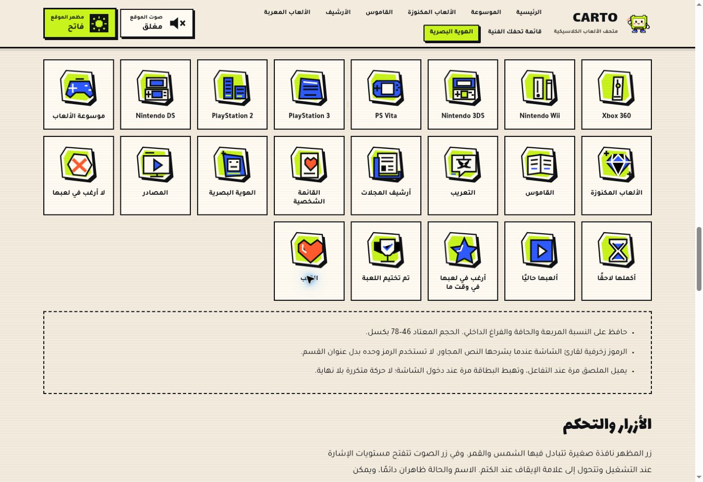

# CARTO — الرموز والحركة والصوت

31 أكتوبر 2026، بتوقيت الرياض.

## التعديلات

- 21 رمز SVG أصليًا: الأجهزة السبعة، ثمانية أقسام، خمسة تصنيفات، والقلب. عائلة موحدة بحواف الملصقات وألوان الليموني والأزرق والبرتقالي. استُبدلت الإيموجي الظاهرة في بطاقات الأجهزة والأقسام والأرشيف وخيارات القائمة وعناوين تصنيفاتها ولوحة الإنجازات. الرموز تصاميم CARTO وليست شعارات الشركات الرسمية.
- ملف الرموز المشترك 11,531 بايت. إجمالي ملفات الرموز والحركة الجديدة نحو 21 كيلوبايت قبل الضغط؛ لا مكتبات إضافية ولا صور أو مؤثرات canvas ثقيلة.
- حركة واضحة مدتها 0.75 ثانية لغالق المظهر والشمس والقمر، ومستويات الصوت وإشارة الكتم. نبضة للقلب، فتح للنافذة، ظهور متتابع للتصنيفات، هبوط واحد للبطاقات، وميل للرموز عند التفاعل. تمتد الاستجابة إلى روابط التنقل والتذييل والعناوين، وتظل النصوص مقروءة أثناء الحركة.
- لا حركة لا نهائية في المؤثرات الجديدة. يتوقف رصد ظهور البطاقة بعد دخولها، وتوجد قواعد لتقليل الحركة.
- تصحيح سبب كان يمنع حركة الصوت عند الضغط على النص أو الأيقونة: تُلتقط الاستجابة قبل إعادة رسم محتوى الزر، وتُحفظ مؤقتات التأثيرات مستقلة.
- رفع معامل المستوى الرئيسي من 0.075 إلى 0.12، أي نحو 4.1 ديسيبل، وإطالة جسم النغمة قليلًا قبل ختامها الناعم. المستوى النهائي يختلف باختلاف سماعات الجهاز.
- إعادة تأليف التشغيل والإيقاف والحفظ والعودة. صوت القلب مستقل عن فتح تفاصيل اللعبة. لكل تصنيف نغمة خاصة تُشغّل بعد نجاح الحفظ: ختام هادئ لعدم الرغبة، توقيت للتأجيل، انطلاق للعب الحالي، وميض للرغبات، وقفلة انتصار للتختيم.
- يبقى الصوت مغلقًا افتراضيًا للزائر الجديد، ويحترم الاختيار السابق. للإنجاز الجديد أولوية صوتية. نغمة العودة ضمن حد التنقل البالغ 260 مللي ثانية.
- توثيق الرموز والحركات والمستوى الجديد داخل صفحة الهوية، مع 14 زر معاينة صوتية؛ النغمة الخامسة عشرة نقرة التنقل الداخلية.
- لم تتغير بيانات الألعاب أو مفاتيح تخزين القوائم والإنجازات والمظهر والصوت.

## التحقق المنفذ

- `node --test tests/*.test.cjs`: 11 اختبارًا ناجحًا، تشمل بيانات 161 لعبة، التنقل، المظهر، تركيز النوافذ، الصوت والموافقة عليه، حفظ البيانات، الإنجازات، الرموز، ربط القلب والتصنيفات بنغماتها، واختبار تراجع لحركة زر الصوت قبل إعادة رسمه.
- نجح فحص بناء جملة ملفات JavaScript و`git diff --check`.
- 48 قياسًا في المتصفح السحابي: 16 مسارًا عند 360 و1366 بكسل بالمظهر الفاتح، و16 مسارًا عند 390 بكسل بالمظهر الداكن. لا تجاوز أفقي لجذر الصفحة في هذه القياسات.
- مراجعة بصرية لرموز الأجهزة والأقسام والأرشيف ومعرض الرموز في صفحة الهوية، وعلى الجوال داخل إطار متجاوب.
- معاينة النغمات العشر الجديدة أو المعدلة داخل مختبر الصوت بنجاح عبر Web Audio؛ أُغلق الصوت بعد الفحص.
- بعد الإصلاح، تأكد تشغيل `carto-meter` للصوت و`carto-shutter` للمظهر، كل منهما لمدة 0.75 ثانية، عند الضغط على النص والأيقونة داخل الزرين.
- حُفظت Forza Horizon في التصنيفات الخمسة بالتتابع، وأُعيد فتح النافذة للتحقق من التصنيف المختار في كل مرة. أُزيلت لعبة التجربة في النهاية؛ لم تُمسح بيانات المتصفح.
- اكتمل نشر نسخة الكود المصححة على GitHub Pages بنجاح.

## حدود الفحص

فحص الجوال كان بإطار متجاوب داخل Chrome، وليس جهاز لمس فعليًا. لا تمثل معاينة Web Audio تقييمًا سمعيًا بشريًا لجودة النغمات. مسار تقليل الحركة مفحوص في الشيفرة وقواعد CSS؛ لم يتوفر تغيير إعداد النظام في المتصفح السحابي.

